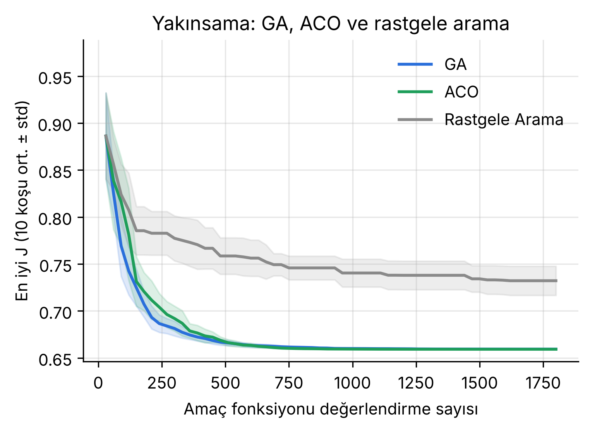

> 🇹🇷 Türkçe · 🇬🇧 [English version below](#english)

# Starship Kalkış PID Optimizasyonu: Genetik Algoritma ve Karınca Kolonisi

Optimizasyon dersi projesi (Kırıkkale Üniversitesi, Elektrik-Elektronik Mühendisliği yüksek lisans) · **Melih Demir**

SpaceX Starship **Super Heavy** booster'ının kalkışının ilk 150 saniyesi için, ileri beslemeli ve iki fazlı (0–75 s / 75–150 s)
PID gaz kolu denetleyicisinin 6 kazancı (Kp1, Ki1, Kd1, Kp2, Ki2, Kd2) iki metasezgisel yöntemle ayarlanır:

- **Genetik Algoritma (GA):** turnuva seçimi, BLX-α çaprazlama, Gauss mutasyonu, elitizm
- **Karınca Kolonisi (ACO_R):** sürekli uzay için arşiv tabanlı ACO (Socha & Dorigo, 2008)

Karşılaştırma için elle ayarlanmış PID ve rastgele arama da çalıştırılır. Tüm algoritmalar hazır kütüphane kullanılmadan, yalnızca NumPy ile yazılmıştır.

## Veri
Kaggle [Starship Launches Dataset (IFT-1 – IFT-8)](https://www.kaggle.com/datasets/arya2209/starship-launches-dataset-ift1-ift8): SpaceX yayınlarındaki telemetrinin OCR ile okunmuş hali. Bu çalışmada IFT-6, IFT-7 ve IFT-8 uçuşlarının booster hız ve irtifa verisi kullanıldı (`veri_data/`).

## Yöntem kısaca
1. **Referans** (`src/referans_reference.py`): OCR verisi temizlenir, polinomla yumuşatılır; hedef hız v_ref(t), uçuş yolu açısı ve max-Q çıkarılır.
2. **Model** (`src/roket_modeli_rocket_model.py`): 1 boyutlu uçuş dinamiği (itki, yerçekimi, sürükleme, kütle azalması, motor gecikmesi); PID + ileri besleme + kazanç programlama; 9 Monte Carlo senaryosu (kütle, sürükleme, itki belirsizliği, motor arızası).
3. **Amaç fonksiyonu J:** takip hatası + son hız hatası + max-Q cezası + yakıt + gaz kolu salınımı (küçük = iyi).
4. **Optimizasyon** (`src/optimizasyon_optimization.py`): GA, ACO ve rastgele arama; her biri 30 × 60 = 1800 değerlendirme, 10 bağımsız koşu.
5. **Test** (`src/deneyler_experiments.py`): en iyi ayarlar eğitimde görülmemiş 200 senaryoda denenir; Mann-Whitney testi.

## Sonuçlar
| Yöntem | En iyi J | Ortalama J | Std | %1'e ulaşma | Başarı |
|---|---|---|---|---|---|
| GA | 0,65916 | 0,65924 | 9,3·10⁻⁵ | 519 deneme | 10/10 |
| ACO | 0,65916 | 0,65916 | 2,7·10⁻⁷ | 546 deneme | 10/10 |
| Rastgele arama | 0,70922 | 0,73213 | 1,6·10⁻² | – | 0/10 |

- GA ve ACO **aynı kazançları** buldu (Kp1 = 0,230, Ki1 = 0,082, Kp2 = 0,155, Ki2 = 0,082, Kd = 0).
- 200 yeni senaryoda elle ayarlı PID'e göre maliyet **%11**, gaz kolu salınımı **%67** azaldı; max-Q sınırı hiç aşılmadı.
- GA kaba aramada biraz hızlı; ACO ince ayarda hızlı ve ~350 kat daha istikrarlı.



## Çalıştırma
```bash
pip install -r gereksinimler_requirements.txt
cd src
python deneyler_experiments.py    # ~6 dk → sonuclar_results/*.csv, *.json
python grafikler_figures.py   # → sonuclar_results/sekiller_figures/*.png
python ablasyon_ablation.py    # tek faz / iki faz karşılaştırması
```

## Klasörler
| Yol | İçerik |
|---|---|
| `src/` | Python kodları |
| `veri_data/` | Kaggle telemetrisi (3 uçuş) |
| `sonuclar_results/` | Tablolar (CSV/JSON) ve şekiller |
| `sunumlar_presentations/` | Bölüm 1 (GA) ve Bölüm 2 (GA + ACO) sunumları (PDF) |

Ortak proje: iniş fazı (PSO ve Gri Kurt) İrem Sert tarafından ayrı bir çalışmada ele alınmıştır.

---

<a id="english"></a>

# Starship Ascent PID Optimization: Genetic Algorithm and Ant Colony Optimization

Optimization course project (Kırıkkale University, M.Sc. Electrical-Electronics Engineering) · **Melih Demir**

The 6 gains (Kp1, Ki1, Kd1, Kp2, Ki2, Kd2) of a feed-forward, two-phase (0–75 s / 75–150 s) PID throttle controller for the first 150 seconds of the SpaceX Starship **Super Heavy** ascent are tuned with two metaheuristics:

- **Genetic Algorithm (GA):** tournament selection, BLX-α crossover, Gaussian mutation, elitism
- **Ant Colony Optimization (ACO_R):** archive-based ACO for continuous domains (Socha & Dorigo, 2008)

A hand-tuned PID and random search are used as baselines. All algorithms are written from scratch with NumPy only.

## Data
Kaggle [Starship Launches Dataset (IFT-1 – IFT-8)](https://www.kaggle.com/datasets/arya2209/starship-launches-dataset-ift1-ift8): OCR-extracted telemetry from SpaceX live streams. Booster speed and altitude of flights IFT-6, IFT-7 and IFT-8 are used (`veri_data/`).

## Method
1. **Reference** (`src/referans_reference.py`): OCR data is cleaned and smoothed with a polynomial; target speed v_ref(t), flight-path angle and max-Q are derived.
2. **Model** (`src/roket_modeli_rocket_model.py`): 1-D flight dynamics (thrust, gravity, drag, mass depletion, engine lag); PID + feed-forward + gain scheduling; 9 Monte Carlo scenarios (mass, drag, thrust uncertainty, engine failure).
3. **Cost function J:** tracking error + final speed error + max-Q penalty + fuel + throttle activity (lower = better).
4. **Optimization** (`src/optimizasyon_optimization.py`): GA, ACO and random search; 30 × 60 = 1800 evaluations each, 10 independent runs.
5. **Test** (`src/deneyler_experiments.py`): best gains evaluated on 200 unseen scenarios; Mann-Whitney test.

## Results
| Method | Best J | Mean J | Std | Evals to 1% | Success |
|---|---|---|---|---|---|
| GA | 0.65916 | 0.65924 | 9.3e-5 | 519 | 10/10 |
| ACO | 0.65916 | 0.65916 | 2.7e-7 | 546 | 10/10 |
| Random search | 0.70922 | 0.73213 | 1.6e-2 | – | 0/10 |

- GA and ACO found the **same gains** (Kp1 = 0.230, Ki1 = 0.082, Kp2 = 0.155, Ki2 = 0.082, Kd = 0).
- On 200 unseen scenarios, cost dropped by **11%** and throttle activity by **67%** compared with the hand-tuned PID; the max-Q limit was never exceeded.
- GA is slightly faster in the coarse search; ACO is faster in fine-tuning and ~350× more consistent across runs.

## How to run
```bash
pip install -r gereksinimler_requirements.txt
cd src
python deneyler_experiments.py    # experiments (~6 min) → sonuclar_results/*.csv, *.json
python grafikler_figures.py   # figures → sonuclar_results/sekiller_figures/*.png
python ablasyon_ablation.py    # single-phase vs two-phase ablation
```

## Folders
| Path | Content |
|---|---|
| `src/` | Python source code |
| `veri_data/` | Kaggle telemetry (3 flights) |
| `sonuclar_results/` | Tables (CSV/JSON) and figures (`sekiller_figures/`) |
| `sunumlar_presentations/` | Part 1 (GA) and Part 2 (GA + ACO) presentations (PDF, in Turkish) |

Joint project: the landing phase (PSO and Grey Wolf Optimizer) is covered in a separate study by İrem Sert.
